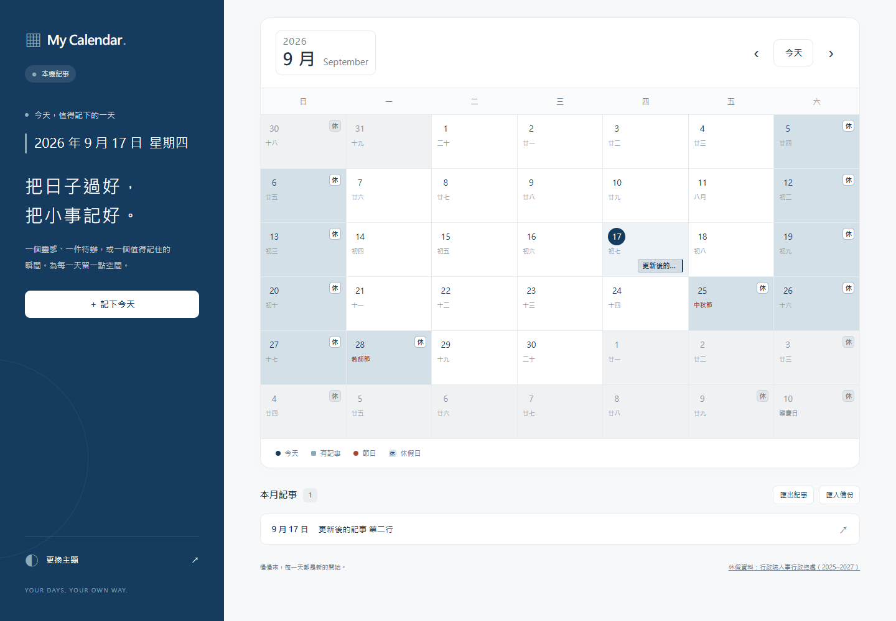
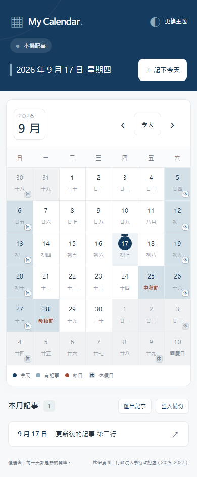

# My Calendar

以原生 HTML、CSS、JavaScript 製作的台灣月曆，整合農曆、節日、官方休假、每日記事與 12 種主題。提供本機記事及 Node.js + MySQL 帳號同步兩種模式。

[開啟展示網站](https://toby0602.github.io/calendar-JS/) · [MySQL 從安裝到使用](docs/MYSQL_SETUP.md)

GitHub Pages 展示本機記事模式。帳號同步需要另行啟動或部署 Node.js 服務並連接 MySQL；GitHub Pages 不執行後端。

## 畫面





## 開發動機與設計

希望在同一個畫面查看台灣常用日期與每日記事，也練習日期邊界、響應式排版、原生對話框、儲存衝突與前後端整合。手機顯示簡短記事標記，桌機顯示摘要，讓農曆保持可讀。

前端保留原生 JavaScript，日期、儲存、渲染與初始化分開維護。後端使用 Express 與 mysql2 參數化查詢；密碼以 scrypt 雜湊，登入使用 HttpOnly、SameSite Cookie。記事在資料庫交易中核對舊內容，避免不同分頁或裝置互相覆寫。

## 本機啟動

需要 Node.js 22.13 以上版本。在專案目錄執行：

```sh
npm ci
npm run dev
```

開啟 http://localhost:3000 。預設使用本機記事，不需要先安裝 MySQL。`npm start` 啟動相同服務但不監看檔案；`npm run dev:static` 只提供靜態網頁。

啟用帳號同步前，請按照 [Windows MySQL 教學](docs/MYSQL_SETUP.md) 建立資料庫、資料表及 `.env`，再執行 `npm run dev:mysql`。

## 功能

- 每日一筆記事，最多 2,000 字元，支援新增、編輯與刪除。
- 農曆、台灣常見節日與官方辦公休假；「休」含週末與補假，「班」為週末補行上班。
- 休假底色跟隨主題；非當月日期淡化；左上角年月按鈕可選擇年份與月份。
- 12 種主題、響應式版面、鍵盤月份導覽、Ctrl / Command + Enter 儲存、Escape 關閉。
- 跨午夜保留編輯中的草稿，關閉對話框後更新「今天」。
- 多分頁記事合併；同日期衝突保留草稿並提示重新開啟。
- JSON 匯出與匯入：只新增不存在的日期；同日期略過，每次最多 1,000 筆、檔案最多 3 MB。
- MySQL 模式提供註冊、登入、登出、帳號資料隔離及明確操作的本機記事匯入。
- 使用文字節點呈現記事，不解析使用者輸入的 HTML。

## 儲存方式

| 模式 | 儲存位置 | 使用限制 |
| --- | --- | --- |
| 本機記事 | 同網址、同瀏覽器的 localStorage | 清除網站資料會移除記事，不跨裝置同步 |
| 帳號記事 | Node.js API 後方的 MySQL | 需登入與網路連線，不同帳號彼此隔離 |
| 主題偏好 | 此瀏覽器的 localStorage | 不隨帳號同步 |

不同網址無法讀取彼此的本機資料。GitHub Pages 的記事不會自動出現在 localhost：請先在原網址「匯出記事」，到新網址登入後「匯入備份」。登入不會自動上傳或刪除本機記事。

HTTPS／localhost 的新版瀏覽器會使用 Web Locks 序列化本機多分頁寫入；不支援時會讀取最新資料再合併，但無法保證極端同時寫入的原子性。建議透過 localhost 或展示網址使用。

帳號功能尚未提供忘記密碼、Email 驗證與自動資料庫備份。正式環境需要 HTTPS、正確的 APP_ORIGIN 與資料庫備份設定。Node.js/MySQL 尚未部署到展示站。

## 程式結構

```text
index.html                  頁面與原生 dialog
css/                        共用、側欄、月曆、對話框與 RWD
js/date-utils.js            日期工具與日期鍵驗證
js/lunar.js                 農曆與文化節日
js/holidays.js              官方 CSV 產生的休假資料
js/updateDate.js            月曆狀態與日期格渲染
js/notes-store.js            本機存取、合併、衝突與匯入
js/postIts.js                記事編輯與列表
js/changeTheme.js           主題與偏好
js/account.js               帳號介面與 API 儲存介面
js/backups.js               JSON 匯出與匯入
js/app.js                   初始化、導覽與跨日更新
server/app.cjs              HTTP API、登入與請求驗證
server/mysql-store.cjs      MySQL 使用者、工作階段與記事交易
server/schema.sql           資料表
scripts/                    開發伺服器、網站匯出與資料產生
tests/                      UI 回歸、帳號流程與 API 契約測試
```

## 測試與部署

```sh
npm test
npm run test:api
npm run test:ui
npm run build
```

UI 測試預設使用本機 Microsoft Edge。其他環境可先執行 `npx playwright install chromium`，再指定 `BROWSER_CHANNEL=chromium`；PowerShell 使用 `$env:BROWSER_CHANNEL='chromium'`。

測試固定日期與台灣時區，涵蓋 10 種尺寸、344px 節日當天的記事標記、農曆與休假、閏年／跨年、CRUD、持久化、文字安全、儲存失敗、JSON 備份、多分頁衝突及跨午夜對話框。帳號測試涵蓋登入、隔離、匯入、重載與登出。

本機未設定測試資料庫時，API 契約測試使用測試替身，真實 MySQL 測試顯示 SKIP。實際資料庫測試須設定獨立的 DB_NAME（以 `_test` 結尾）與 RUN_MYSQL_TESTS=1，見 [教學](docs/MYSQL_SETUP.md#測試專用資料庫)。

GitHub CI 啟動 MySQL 8.4，執行真實資料庫/API 與 Chromium UI 測試，再核對休假資料產物。全部通過才發布 `_site/`；Pull Request 只執行檢查。`_site/` 僅包含公開資產，不包含 `.env`、伺服器或開發依賴。

## 日期與資料來源

農曆使用瀏覽器 Intl 中國曆，將指定民用日期轉為台灣中午計算；不支援時仍可使用國曆。文化節日與休假分開。清明在 2000–2099 年使用近似公式，個別日期請以官方公告為準。

內建 2025 年修正版、2026 年與 2027 年行政院人事行政總處辦公日曆，來源與授權見 [data/SOURCES.md](data/SOURCES.md)。其他年份會提示尚無官方資料；個別職場排班可能不同。資料內建，瀏覽月曆不需即時下載 CSV。

更新時將官方資料存成 UTF-8 的 `data/dgpa-YYYY.csv`，執行 `npm run build:holidays`。產生程式會檢查日期、重複列及完整年度。本機月份範圍為 100–9999 年，MySQL 模式為 1000–9999 年。
